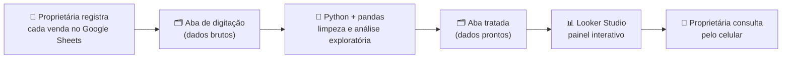

<div align="center">

# 📊 Painel de BI para a Virtuau Modas

**Vendas e fiados de uma loja real, reunidos em uma base única e em um painel que se abre no celular.**


</div>

---

## 📌 Sobre o projeto

Projeto extensionista do **Bootcamp Business Intelligence e Big Data** (UNISAGRADO, Ciência da Computação EAD, 2026/2). A regra do módulo é resolver uma necessidade **real** de uma organização real, então o trabalho é feito com a **Virtuau Modas**, uma loja online de roupas femininas de Macatuba/SP.

### O problema

| Hoje, na loja | Consequência |
|---|---|
| Os pedidos chegam por **WhatsApp**, **Instagram** e **caderninho** | Não existe uma fonte única de dados |
| O fiado é marcado com etiqueta no WhatsApp e cobrado no fim do mês | É difícil saber quanto há a receber e de quem cobrar primeiro |
| Promoções acontecem em peças paradas e em datas comemorativas | A decisão é feita no olho, sem números |
| Cerca de 20 vendas por semana, peças de R$ 50 a R$ 200, sem produto fixo | O mix muda o tempo todo e dificulta a reposição |

### A solução

Uma **base única de vendas e fiados** que a proprietária alimenta pelo celular, tratada em Python e exibida em um **painel interativo** que ela abre a qualquer hora, sem mudar a rotina de anotar cada venda na hora.

O painel deve ajudar a responder:

- 🛍️ O que mais vende (tipo de peça, faixa de preço, origem do pedido)?
- 💸 Quanto há de fiado a receber e há quanto tempo?
- 🏷️ Quais peças estão paradas e merecem promoção?
- 📅 Quais datas e semanas vendem mais?
- 🔁 O que vale repor?

---

## 🧭 Como funciona



A Flaviane só digita. O tratamento é feito por mim, e o painel lê a aba tratada e se atualiza sozinho.

---

## 🗃️ Modelo de dados

Uma linha por venda, sem nomes de clientes:

| Campo | Descrição |
|---|---|
| `data` | Data da venda |
| `origem` | WhatsApp, Instagram ou caderninho |
| `tipo_peca` | Top, cropped, vestido etc. |
| `faixa_preco` | Faixa de preço da peça |
| `valor` | Valor da venda |
| `forma_pagamento` | À vista, Pix, cartão ou fiado |
| `situacao_fiado` | Em aberto ou pago, e data do recebimento |
| `evento` | Black Friday, data comemorativa ou nenhum |

---

## 🗓️ Plano e status

| Etapa | O que será feito | Prazo | Status |
|---|---|---|---|
| 1 | Contato e levantamento com a proprietária, autorização de uso dos dados | 25/10/2026 | ✅ Concluída |
| 2 | Planilha única e digitação de 3 meses de caderninho; primeira versão mostrada à proprietária | até 05/11/2026 | 🔄 Em andamento |
| 3 | Limpeza e análise exploratória em Python (pandas) | até 15/11/2026 | ⏳ Pendente |
| 4 | Painel em Looker Studio e ajustes com o retorno da proprietária | até 25/11/2026 | ⏳ Pendente |
| 5 | Relatório final, código-fonte e apresentação | entrega 03/12, apresentação 04 ou 05/12 | ⏳ Pendente |

**Entregas do módulo**

- **Entrega 1** (proposta, 06/11/2026): [Relatório-Inicial](Relatórios%20de%20Entrega/Relatório-Inicial.docx)
- **Entrega 2** (relatório final, 03/12/2026): [Relatório-Final](Relatórios%20de%20Entrega/Relatório-Final.docx), em preenchimento

---

## 🛠️ Tecnologias

| Uso | Ferramenta |
|---|---|
| Registro das vendas | Google Sheets |
| Tratamento e análise | Python, pandas, Jupyter |
| Painel interativo | Looker Studio |
| Contato com a proprietária | WhatsApp |
| Versionamento | Git e GitHub |

> **Por que não Power BI?** Compartilhar o painel com a proprietária exigiria licença Pro dos dois lados e e-mail institucional. O Looker Studio é gratuito, abre bem no celular e se atualiza sozinho.

---

## 📁 Estrutura do repositório

```text
.
├── README.md
└── Relatórios de Entrega/
    ├── Relatório-Inicial.docx        # Entrega 1 (proposta)
    ├── Relatório-Final.docx          # Entrega 2 (em preenchimento)
    └── Conversas com Empresa/        # evidência do contato inicial
```

Conforme o projeto avançar, entram aqui as pastas de dados tratados e de notebooks.

---

## 🔒 Privacidade

- Os dados **não contêm nomes de clientes**.
- A proprietária autorizou o uso dos dados, a citação da loja e da cidade (Macatuba) no relatório e o retorno sobre o painel antes da entrega final.
- Este repositório não publica dados identificáveis de clientes.

---

## 👤 Autor

**Nickolas Passos Homem de Mello**
Ciência da Computação (EAD), UNISAGRADO. Projeto individual (Grupo 4).
Professor responsável: Roque Maitino Neto.

[GitHub: MelloNickolas](https://github.com/MelloNickolas)
